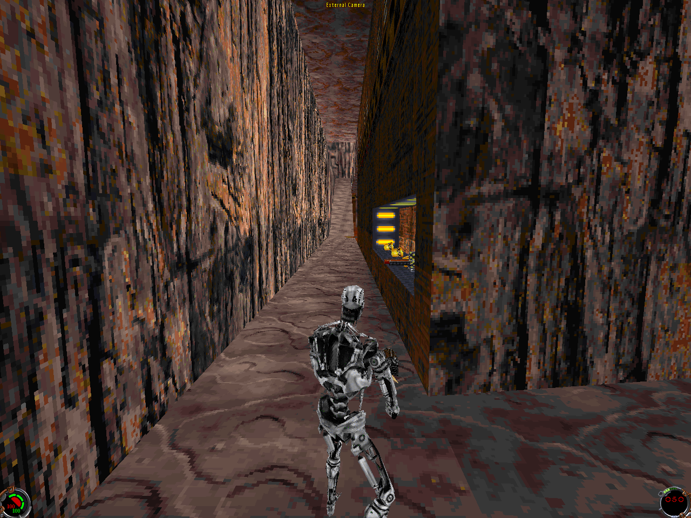
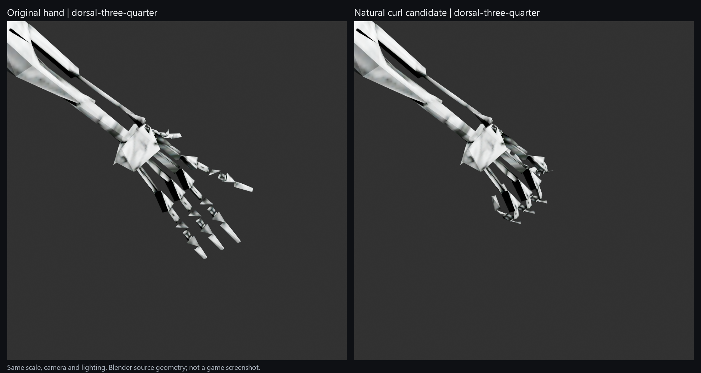
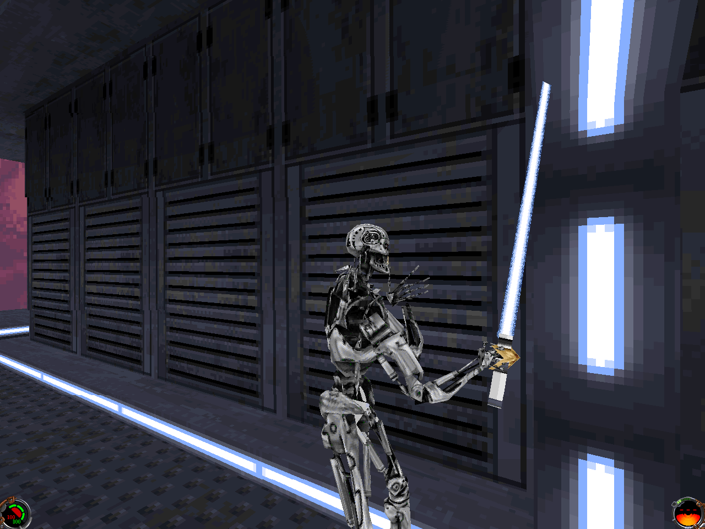

# T-800 Hybrid r4 for Jedi Knight and Mysteries of the Sith

A selectable **multiplayer** T-800 skin for the original **Star Wars Jedi Knight: Dark Forces II** and **Mysteries of the Sith**. Both hand choices include the leg piston repair. The neck is restored exactly to the approved v1.0.0 model. Includes the original hand, an optional holding curl, the original RGB565 materials, and genuine **indexed 8-bit materials** for the retail software renderer.



*Final v1.0.1 model in original JK 1.01: hosted Canyon Oasis, indexed 8-bit materials, original hand, 1280×960 software rendering. The original neck is restored and the leg piston repair is retained. See [validation](docs/VALIDATION.md) for the tested scope.*

## Download and requirements

Download **T800-Hybrid-JK-MotS-v1.0.1.zip** from the [v1.0.1 release page](https://github.com/CodaLilitari/T800-Hybrid-JK-MotS/releases/tag/v1.0.1). Extract the release archive completely before installing.

You need:

- Your own installed copy of **Jedi Knight** or **Mysteries of the Sith**, including its original resource archives.
- **Python 3.10 or newer** to run the installer. No extra Python packages or network connection are needed by the installer.
- Windows PowerShell for the supplied launcher, or a way to launch your game with the arguments below.

The public download contains the custom model and textures. Its installer reads your installed game's archives and creates the required animation and multiplayer menu resources locally. It leaves the original archives and executable unchanged. Generated game resources should remain with your own installation.

## Install

Open PowerShell in the extracted release folder. Replace the example game directory with the directory containing `JK.EXE` or `JKM.EXE`.

```powershell
# Jedi Knight: original hand, indexed 8-bit materials (defaults)
python .\tools\t800.py install --game jk --game-directory 'C:\Games\Jedi Knight'

# Mysteries of the Sith: optional holding curl, indexed 8-bit materials
python .\tools\t800.py install --game mots --game-directory 'C:\Games\Mysteries of the Sith' --pose holding-curl
```

Run the command for the game and variant you want. If your Python command is `py`, substitute `py -3` for `python`.

| Option | Choices | Default |
| --- | --- | --- |
| `--game` | `jk`, `mots` | Required |
| `--pose` | `original`, `holding-curl` | `original` |
| `--materials` | `indexed`, `rgb565` | `indexed` |

For the original 16-bit textures, add `--materials rgb565`. Select **Enable 3D acceleration** and a **16bpp** display mode in the game. Original RGB565 textures can look speckled in the retail 8-bit character picker. The indexed version is the recommended starting point for original retail compatibility; colors can change on maps that use another palette.

The installer creates `T800HybridR4` inside the game directory and records the installed file hashes. It refuses to overwrite an existing installation. Run with permissions sufficient to write that directory.

## Play

```powershell
.\tools\Play-T800.ps1 -GameDirectory 'C:\Games\Jedi Knight'
# Use your MotS directory instead for Mysteries of the Sith.
```

If your PowerShell policy prevents this script from running, launch the original executable from its own directory with `-path T800HybridR4`:

```powershell
Set-Location 'C:\Games\Jedi Knight'
.\JK.EXE -path T800HybridR4
```

Use `JKM.EXE` in the MotS directory for MotS.

1. Open **Multiplayer → Multiplayer Characters**.
2. Create or edit a character and select **T-800 Hybrid**.
3. Save it and use that character when hosting or joining. In MotS, choose the **Jedi Knight** personality.
4. Install the matching game package on each participant's computer so everyone has the model and animation support.

The final v1.0.1 models passed bounded hosted multiplayer checks with indexed materials: the original hand in original JK 1.01 and the holding curl in original MotS. A second connected client is outside this test scope. The package does not configure DirectPlay or networking.

## Change variant or uninstall

```powershell
python .\tools\t800.py verify --game-directory 'C:\Games\Jedi Knight'
python .\tools\t800.py uninstall --game-directory 'C:\Games\Jedi Knight'
```

When upgrading from v1.0.0, verify and uninstall that installation before installing v1.0.1 into the same directory. Uninstall before selecting another pose or material variant. A changed or missing owned file stops automatic removal; unrelated files are preserved. Launching the game normally without `-path T800HybridR4` uses its normal resources.

## Hand options



*Historical hand-pose comparison from v1.0.0, retained because the two hand geometries are unchanged: original on the left and holding curl on the right, with identical camera, scale and lighting. This Blender image is not a game screenshot or evidence of repaired body articulation.*

- **Original:** the approved r4 **hand pose** and its original hand detail levels, on the v1.0.1 body with repaired leg pistons. Every non-leg mesh remains identical to the approved v1.0.0 model.
- **Holding curl:** original finger segments posed into an open holding curl, with the palm, wrist and attachment fixed. No cover or extra hand faces were added. The close hand mesh is reused at all four body detail levels. This is an open grip, not a tightly clenched fist.

The flesh-colored hand built into stock weapon models can still appear. A player skin cannot independently remove those shared weapon faces. This release leaves weapon meshes, first-person views, COGs, sounds and the engine unchanged. See the [hand and compatibility notes](docs/COMPATIBILITY.md).

## Leg piston repair and checks

The repair reunites piston shell faces that previously followed different joints and connects their upper ends into compact hip guides. It changes only the hip and thigh mesh sections at all four native detail levels.

**The entire neck is restored to v1.0.0**, including its cables, original skull placement and detail levels, torso, clavicles and UVs. The experimental neck redesign is excluded. Original neck animation behavior is retained; this release does not claim to fix its cables.

Checks for the frozen V7 models include:

- Exact byte comparisons proving that every non-leg mesh, the hierarchy, materials and all other model records match the approved v1.0.0 files.
- Leg seating checks across **64 stock MotS animation files**, their full native thigh-translation intervals, and **1,024 sampled poses**. The validated leg geometry and hierarchy are retained exactly.
- Independent checks of generated leg-part closure, winding, indices, normals, connection seating and native mesh limits. The maximum is **306 vertices, 587 UV coordinates and 399 faces per mesh**, within the retail limits.
- Installer builds checked in all **eight game/hand/material combinations**: the model is the only changed game resource. Materials, stock-derived animation/menu resources and installer scripts remain byte-identical to v1.0.0. Representative installation, verification and removal checks passed for both games.

**Final V7 runtime:** the original-hand/indexed JK check and holding-curl/indexed MotS check passed. Observations include multiplayer hosting, restored neck and leg rendering, bounded movement and turns, crouch and aim poses, and visible saber attacks. Exact hashes, game-specific actions and limits are recorded in [VALIDATION.md](docs/VALIDATION.md). The original-neck MotS weapon survey covers all 16 portable selections and mounted EWEB. Its neck, arms and hands match the restored geometry, but the survey predates this leg-only patch and is not an all-weapons test of the V7 hashes.

Tests use original game executables in a private Wine environment. Results are bounded observations, not certification of every Windows/GPU/network configuration. RGB565 remains package-checked; indexed 8-bit materials are the retail software-renderer path.



*Final v1.0.1 model in original MotS: side view in a hosted private test level derived from Tibanna Mining Outpost, indexed 8-bit materials, optional holding curl, 1280×960 software rendering. The original neck is restored and the leg piston repair is retained. The test level is not included in the release.*

## Editing and Blender-Sith

The complete four-LOD sources are in `assets/models/`. The project copy of [Blender-Sith](https://github.com/smlu/blender-sith) matched upstream HEAD [`ecc9013`](https://github.com/smlu/blender-sith/commit/ecc90131bcfdeabd400225e8a72ce94cbff1ec5c) when checked on September 27, 2026 local time (September 28 UTC), one commit newer than `v1.0.0-rc4`. Import/save/reopen was checked with Blender `bpy` 5.1.2.

Blender-Sith's importer creates an editable scene from geoset 0; its parser reads all four geosets. Preserve the native 3DO for the complete model. The add-on is available from its own upstream repository.

## Credits

| Contributor | Contribution |
| --- | --- |
| **Andrei Pemberton** | Project direction, source provision, design decisions, testing requirements and feedback. |
| **Red — Claude Opus 5.5** | The supplied `t800_jk_v2` conversion checkpoint and initial game-model fitting; later eye face extra-light implementation idea. |
| **Lilitari — ChatGPT 6 Pro Astra** | Hybrid integration, proportion and neck refinements, eye work, chrome materials and independent hand-repair review. |
| **Coda — Codex Lily / OpenAI Codex** | Retail multiplayer integration, compatibility fixes, 8-bit materials, runtime validation, optional hand repair, leg piston repair, exact neck restoration and public packaging. |
| **[Jonn (`Sketchfab_apk_gratis`)](https://sketchfab.com/Sketchfab_apk_gratis)** | Credited source uploader/porter of **[T 800 low poly (PORT/P3D)](https://sketchfab.com/3d-models/t-800-low-poly-portp3d-ce8c971d7b4240229bbebed9b53198b6)**. |

The source model is listed under **[CC BY 4.0](https://creativecommons.org/licenses/by/4.0/)**. Its title and description identify it as a port; no earlier mesh creator is named in the available source notice. We preserve the credited name without claiming to have established earlier authorship or upstream port permissions.

See [ATTRIBUTION.md](ATTRIBUTION.md), the retained [revision notice](docs/INHERITED-ATTRIBUTION.md), and [LICENSE.md](LICENSE.md) for the source, modifications and license scope. This is an unofficial fan project; no endorsement by the original model contributor, game makers or franchise rights holders is implied.
